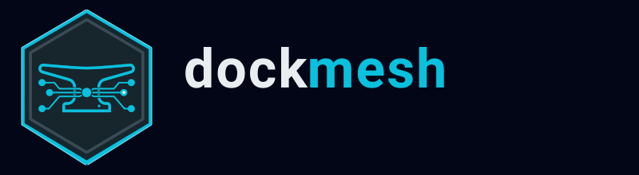
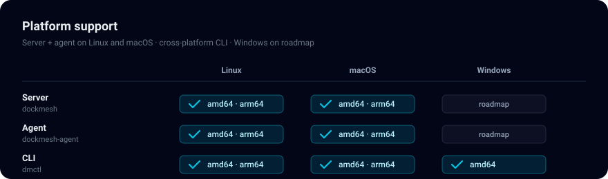
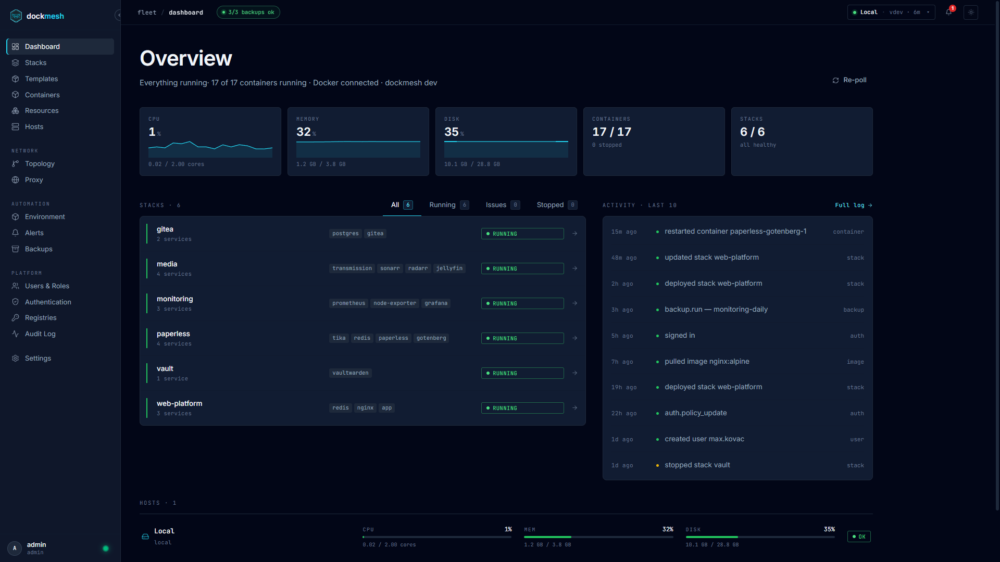
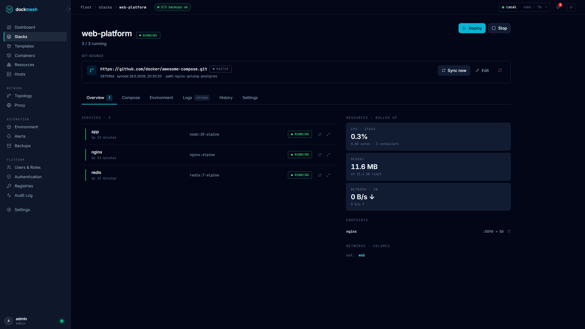
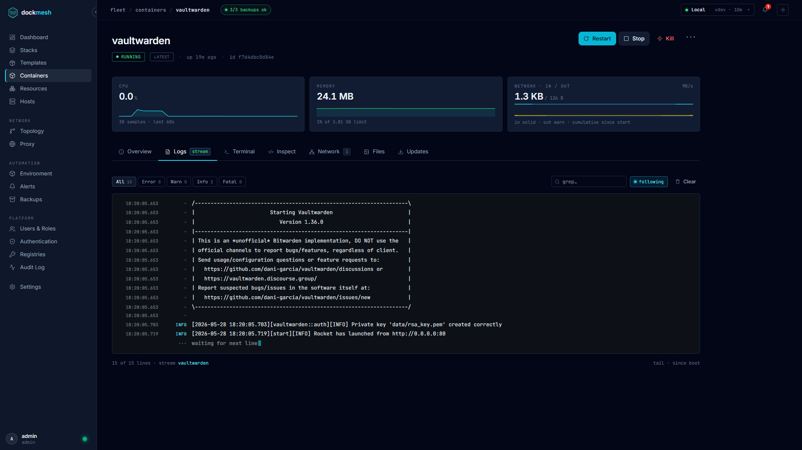
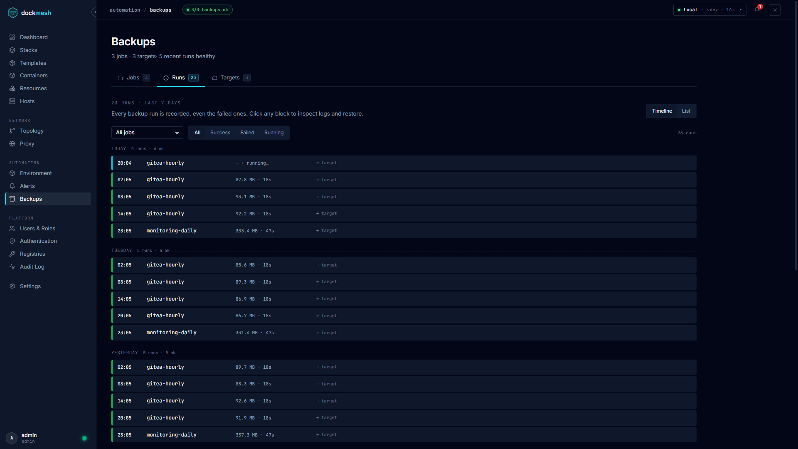
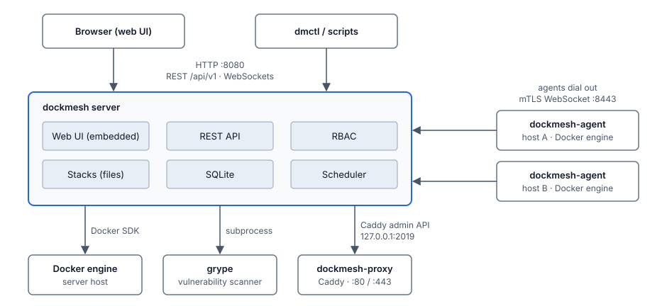

<p align="center">
  
</p>

<p align="center">
  <b>The single-binary Docker fleet manager. 100% open source. No paywalls.</b>
</p>

<p align="center">
  <a href="https://github.com/dockmesh/dockmesh/releases/latest"></a>
  <a href="https://github.com/dockmesh/dockmesh/actions/workflows/release.yml"></a>
  <a href="LICENSE"></a>
  <a href="https://dockmesh.dev"></a>
</p>

---

dockmesh is a lightweight Docker fleet-management platform. One Go binary,
one SvelteKit UI, outbound-only agents on every other host. Stacks live on
disk as plain `compose.yaml` files — the filesystem is the source of truth,
the DB just indexes it. RBAC, SSO, audit log, encrypted backups, CVE
scanning, and multi-host orchestration ship free in the single binary —
no "community edition", no feature gates, no per-node pricing.

## One-line install

```bash
curl -fsSL https://get.dockmesh.dev | sudo bash
```

That pulls the latest release binary (amd64 or arm64) to
`/usr/local/bin/dockmesh`, verifies its checksum, starts the service and
prints the setup wizard URL, `http://<host>:8080/setup`. The wizard asks
for the data directory, service user, admin account and public URL.
For a setup without a browser, install with `DOCKMESH_NO_BOOTSTRAP=1`
and run `sudo dockmesh init` instead.

**Requirements on the host:** Docker Engine (Linux) or Docker Desktop (macOS) with the daemon running, `curl` + `tar` + `sha256sum`, `sudo` access, and ports `8080` + `8443` free. The installer creates the `dockmesh` service user, systemd unit (or launchd plist on macOS), and all state dirs — see [the full requirements matrix](https://dockmesh.dev/docs/installation/#requirements) for distro-specific install hints.

Prefer Docker? See [Docker Compose](#docker-compose) below.

## Platform support

<p align="center">
  
</p>

The server runs natively on Linux (systemd, `/var/lib/dockmesh`) and macOS (launchd, `/usr/local/var/dockmesh`), on amd64 and arm64. The install script detects the host OS and sets up the right service manager. The one-line agent installer enrolls Linux hosts with systemd (amd64 or arm64). The `dmctl` CLI is additionally built for Windows so Windows users can drive a dockmesh server from their workstation; the server and agent do not run on Windows.

## Features

Everything is included in the single binary. There is no paid tier.

<table>
<tr><td>

**Container & Stack management**
- Compose-first: stacks are `stacks/<name>/compose.yaml`
- Deploy / stop / restart / scale / rolling update
- Rollback history (snapshot compose + resolved images per deploy)
- Stack dependencies (base-stacks deploy first, refuse delete on deps)
- Env overrides + global env vars injected at deploy time
- Git source: auto-pull + auto-deploy on push or webhook
- Templates gallery (one-click deploys)

</td><td>

**Multi-host fleet**
- Outbound-only mTLS agents (no inbound ports on remote hosts)
- Per-host picker + `all` mode fan-out views
- Deploy stacks to any host from the same UI
- Stack migration across hosts (preflight check + volume transfer)
- Role assignments scoped to hosts, host tags or stacks (per-team isolation)
- Agent upgrades pushed from the server (manual, staged or automatic)

</td></tr>
<tr><td>

**Security**
- Custom RBAC roles with granular permissions
- SSO via OIDC (Keycloak, Authelia, Authentik, Azure AD, Google, GitLab), SAML (Azure AD, AD FS, Okta), OAuth2 (GitHub, Gitea) and LDAP
- TOTP 2FA + single-use recovery codes
- SHA-256 hash-chained audit log
- age-encrypted stack `.env` files at rest
- In-place age key rotation (no service restart)

</td><td>

**Observability**
- Live CPU / memory / disk per host with smoothed metrics
- Live container stats + log streaming with auto-reconnect
- Container exec over WebSocket
- Alert rules for CPU/memory thresholds and for events: restart loops, OOM kills, offline hosts, full disks, failed backups, expiring certificates
- Notification channels: Slack, Discord, Teams, email, ntfy, Gotify, Pushover, PagerDuty, webhooks
- Prometheus `/metrics` endpoint

</td></tr>
<tr><td>

**Backups & DR**
- Scheduled backups of volumes, stacks, or whole system
- Pre/post hooks for application-consistent DB dumps
  (PostgreSQL / MySQL / MariaDB / Redis / MongoDB)
- Local, SMB (NAS), SFTP, WebDAV, or S3 targets
- Encrypted with age — the same key the stack `.env` uses
- Restore of volumes, stacks or the whole system from the UI; the
  archive is checked against its recorded checksum before anything is
  overwritten
- Verify reads an archive and checks its contents without touching the
  live install

</td><td>

**Networking & Extras**
- Optional reverse proxy with automatic HTTPS (Caddy in a managed `dockmesh-proxy` container)
- Per-host port-conflict detection at deploy time
- CVE scanning with Grype (image-level + fix-in column)
- Private registry credentials (age-encrypted at rest)
- `dmctl` CLI for CI/CD + scripted deploys
- `dockmesh import compose-dir` adopts existing compose directories as stacks
- Web UI in English and German, chosen per user

</td></tr>
</table>

## Screenshots

See [dockmesh.dev](https://dockmesh.dev) for the live marketing carousel with all
hero shots.

| | |
| :-: | :-: |
|  |  |
| Dashboard with live fleet overview | Stack detail with GitOps auto-sync |
|  |  |
| Live container logs with filtering | Scheduled encrypted backups |

## Architecture

<p align="center">
  
</p>

- **Single binary**. Go, with the SvelteKit UI embedded via `go:embed`. The optional reverse proxy runs Caddy as a separate `dockmesh-proxy` container, which Dockmesh pulls (a pinned, tested Caddy version) when you enable the proxy and configures through Caddy's admin API. CVE scanning uses Grype, a separate binary that `scripts/install.sh` installs unless `DOCKMESH_NO_SCANNER=1` is set.
- **Filesystem as source of truth**. Stacks live at `stacks/<name>/compose.yaml`. The DB indexes deployment state; the actual config is always on disk where you can grep, `git log`, and `vim` it.
- **Outbound-only agents**. Remote hosts open a WebSocket to the server — no inbound port to firewall, no VPN, no reverse tunnel. mTLS client certs per agent, revokable.
- **No Kubernetes**. Docker + Compose + a spine of management tooling. If you want K8s, use Rancher. If you want zero-config Docker across a fleet, use dockmesh.

## Install options

### Bare-metal / VM (recommended)

```bash
curl -fsSL https://get.dockmesh.dev | sudo bash
```

Then finish the setup wizard at `http://<host>:8080/setup`.

### Docker Compose

No container image is published. Build it from a checkout with the
bundled `docker-compose.yml`:

```bash
git clone https://github.com/dockmesh/dockmesh && cd dockmesh
docker compose up -d --build
```

The UI is then on port 8080, and the generated `admin` password is
printed in `docker compose logs dockmesh` (it stays in that log, so change it after the first sign-in). The container needs the
Docker socket mounted, as in the compose file.

### Install an agent on a remote host

From the UI: `Hosts → Add host`, copy the one-line enroll command to the
remote host (Linux with systemd, amd64 or arm64). The installer handles
the systemd unit and first handshake.

## Quick start

After the setup wizard:

1. **Log in** at `http://<host>:8080` with the admin account you created
2. **Create a stack**: `Stacks → New stack` → paste a compose.yaml → `Create & deploy`
3. **(Optional) Enroll a second host**: `Hosts → Add host` → run the
   install one-liner on the remote host
4. **(Optional) Set up backups**: `Backups → New backup job` → pick a source → pick a target (SMB / S3 / SFTP / WebDAV / local) → save
5. **(Optional) Turn on the reverse proxy**: `Reverse proxy → Enable proxy` → `New site`. Dockmesh starts the Caddy container, which requests the certificates
6. **(Optional) Switch the language**: user menu → `My account` → `Language` (English or German)

## Documentation

- [Installation](https://dockmesh.dev/docs/installation/)
- [Quick start](https://dockmesh.dev/docs/quickstart/)
- [Multi-host setup](https://dockmesh.dev/docs/features/multi-host/)
- [Backups & DR](https://dockmesh.dev/docs/features/backups/)
- [RBAC & SSO](https://dockmesh.dev/docs/security/)
- [Disaster recovery playbook](https://dockmesh.dev/docs/operations/disaster-recovery/)

## Community & support

- **Issues & bug reports**: [github.com/dockmesh/dockmesh/issues](https://github.com/dockmesh/dockmesh/issues)
- **Feature requests**: same — use the "enhancement" label
- **Website**: [dockmesh.dev](https://dockmesh.dev)

## Development

```bash
# Frontend + backend in watch mode
make dev

# Build single binary with embedded UI
make build

# Run unit tests and svelte-check
make test
```

Tech stack: Go, SvelteKit 2 with Svelte 5 runes, Tailwind v4, SQLite.
Caddy (reverse proxy container) and Grype (scanner binary) are separate
components, not part of the Dockmesh binary.

### A note on AI

Spec, architecture, and design decisions are mine. Implementation is
done with Claude Code as a coding assistant — each change reviewed,
tested, and dogfooded on my own homelab before it hits a release tag.
Flagging this up-front rather than hiding it.

## License

dockmesh is released under the **GNU Affero General Public License v3.0**
(AGPL-3.0-only). See [LICENSE](LICENSE).

The AGPL is chosen deliberately: modifications made available as a network
service must be contributed back. That keeps the project sustainable and
prevents SaaS-loophole exploitation.

## Contributing

See [CONTRIBUTING.md](CONTRIBUTING.md). By contributing you agree that
your work is licensed under AGPL-3.0.

## Security

Never report vulnerabilities in public issues. See [SECURITY.md](SECURITY.md).
