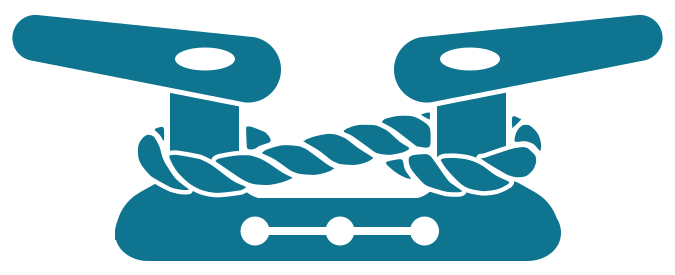
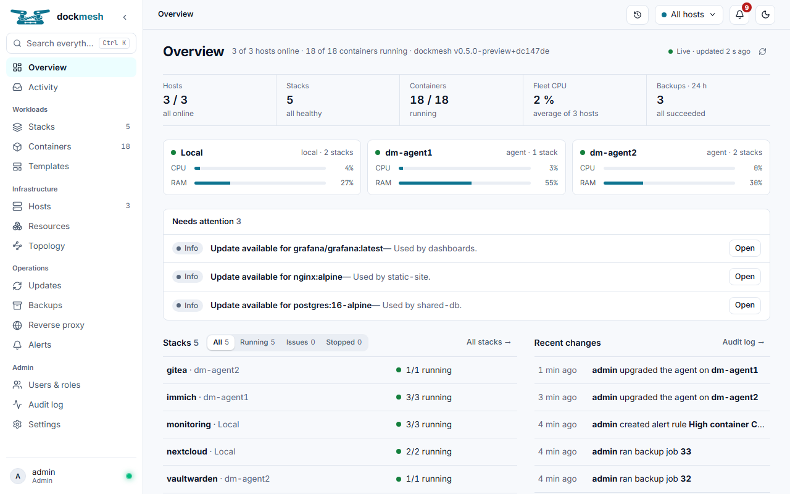

<p align="center">
  <picture>
    <source media="(prefers-color-scheme: dark)" srcset=".github/logo-dark.svg">
    
  </picture>
</p>

<h1 align="center">Dockmesh</h1>

<p align="center">
  Manage Docker Compose stacks on all your hosts from one web UI.<br>
  One binary, outbound-only agents, free and open source.
</p>

<p align="center">
  <a href="https://github.com/Dockmesh/dockmesh/releases/latest"></a>
  <a href="LICENSE"></a>
  <a href="https://dockmesh.dev"></a>
</p>

<p align="center">
  <picture>
    <source media="(prefers-color-scheme: dark)" srcset=".github/shots/overview-dark.png">
    
  </picture>
</p>

## What it is

Dockmesh is a web UI for Docker hosts that run Compose stacks. The server is a single Go binary with the UI
built in; every other host runs a small agent that connects out to the server, so remote hosts need no open port.
Stacks stay plain `compose.yaml` files on disk — you can still edit them, version them with git or run
`docker compose` by hand.

It is built for homelabs and small teams with a handful to a few dozen hosts. It does not manage Kubernetes.

## Features

- **Stacks** — deploy, update and roll back compose stacks; git sources with auto-deploy; templates; move a stack to another host
- **Hosts** — one view across all hosts; agents over mTLS with outbound connections only; drain a host; agent upgrades from the UI
- **Updates** — see which images have a newer version, update one or many, roll back to the previous image
- **Backups** — scheduled, age-encrypted backups of volumes, stacks and Dockmesh itself to local disk, SMB, SFTP, WebDAV or S3; read back and verified after every run; restore from the UI
- **Reverse proxy** — optional Caddy with automatic HTTPS, per-site options, import of an existing Caddyfile
- **Alerts** — container CPU and memory, restart loops, stopped, unhealthy or OOM-killed containers, offline hosts, disk usage, failed or overdue backups and expiring certificates; sent to email, Discord, Slack, Teams, ntfy, Gotify, Pushover, PagerDuty or a generic webhook
- **Access** — roles per area with host, tag or stack scope; SSO with OIDC, SAML, LDAP and OAuth2; 2FA; hash-chained audit log
- **Security scans** — image vulnerability scans with Grype

Everything is in the open source release. There is no paid edition.

## Install

On a Linux host with Docker Engine running:

```bash
curl -fsSL https://get.dockmesh.dev | sudo bash
```

The installer picks the amd64 or arm64 build, verifies its checksum, puts the binary in `/usr/local/bin`, creates a service user and a systemd unit and starts Dockmesh.
Open the link the installer prints (`http://<host>:8080/setup#<code>`) to create the admin account and finish the setup; `sudo dockmesh setup new-code` prints a new one.

Other hosts: in the UI go to **Hosts → Add host** and run the command it shows on that host (Linux with systemd).

Requirements, macOS, manual and from-source installs: [installation guide](https://dockmesh.dev/docs/getting-started/installation/).

## Upgrade

Dockmesh shows a banner in the UI when a new release is out. To upgrade the server, run the installer again
(see the [upgrade guide](https://dockmesh.dev/docs/operations/upgrade/)); database changes are applied on start.
Agents are upgraded from **Hosts**. Read the [changelog](CHANGELOG.md) before a minor release.

## How it works

- **Server:** Go with the SvelteKit UI embedded, SQLite for state. Stacks live in `stacks/<name>/compose.yaml`.
- **Agents:** connect to the server over a WebSocket with mTLS client certificates; each one can be revoked.
- **Proxy and scanner:** Caddy runs in a separate `dockmesh-proxy` container when you enable it; Grype is a separate binary.

## Project status

Dockmesh is before 1.0. Every release candidate is installed and tested on lab VMs before it is tagged; minor
releases get the full run (server and agents, upgrades, every backup target, SSO sign-in). See the [changelog](CHANGELOG.md). Breaking changes are listed there with
upgrade notes.

## Community

- Questions and ideas: [Discussions](https://github.com/Dockmesh/dockmesh/discussions)
- Bugs and feature requests: [Issues](https://github.com/Dockmesh/dockmesh/issues) (👍 an existing issue instead of opening a duplicate)
- Security problems: never in public issues, see [SECURITY.md](SECURITY.md)
- Contributing: [CONTRIBUTING.md](CONTRIBUTING.md)

## A note on AI

Parts of the code are written with AI assistance. Every change is reviewed and tested before it ships.

## License

[AGPL-3.0-only](LICENSE). If you offer a modified Dockmesh as a network service, you have to publish your changes.
